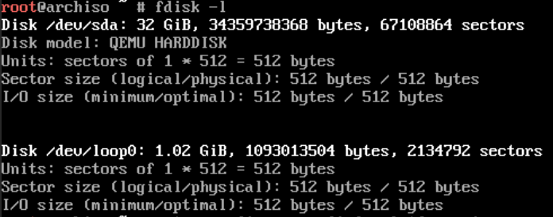
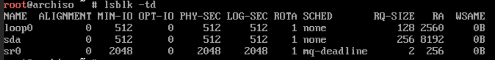
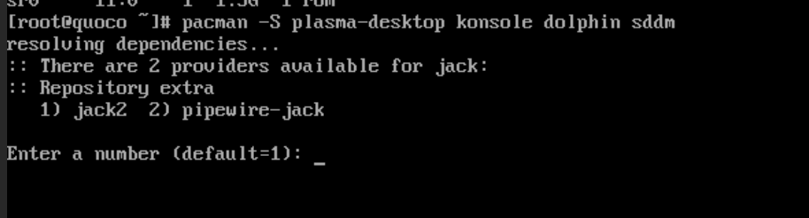

# Arch Linux Install

**Boot the Live Environment**
Boot the environment and select the install via installation medium (this is the ISO image). From here, you will be logged into the virtual console as the root user.

**Verify the Boot Mode**
The following command tells us what our boot mode is. My output was "No such file or directory," indicating that we're in BIOS.
```
cat /sys/firmware/efi/fw_platform_size
```

**Connect to Internet**
Check if your network interfaces are listed and enabled with the following command. Mine was ens18. Since this is a VM, it will treat its connection as a wired ethernet connection.
```
ip link
```
Test the connection. I did the following commands. They properly pinged, so the connection was set up.
```
ping -c 3 google.com
ping ping.archlinux.org
```

**Update System Clock**
We need to update the live system's clock. We try the following command, which will sync the time automatically once connected to the internet.
```
timedatectl
```

**Disk Partitioning**
This command tells us our block devices.
```
fdisk -l
```

Ignore loop0 and focus on sda.

"Check that your NVMe drives and Advanced Format hard disk drives are using the [optimal logical sector size](https://wiki.archlinux.org/title/Advanced_Format "Advanced Format") before partitioning."
```
lsblk -td
```

For sda, PHY-SEC and LOG-SEC match so no problems.

Use the command fdisk for partitioning.

The commands in order: targets sda to partition, creates new partition layout. Creates a partition for SWAP. Then, creates a partition for sda2.

Note: at first, I accidentally created a GPT table rather than an MBR table. MBR is simpler because I'm booted into BIOS. From my understanding, GPT works too, but MBR is simpler and the default for BIOS so i replaced it. The commands below partition sda into 4gb for the swap, and the remaining gb for the root directory.
```
fdisk /dev/sda
o
n
p
1
default
+4G

n
p
2
default
default
w
```

**Format Partitions**
Identify existing file systems. Ensure the partitions are unmounted and have no existing filesystem. 
```
lsblk -f
```
The first command initializes the SWAP; the second creates ext4 filesystem on /dev/sda2
```
mkswap /dev/sda1 
mkfs.ext4 /dev/sda2
```

**Mount Partitions**
```
mount /dev/sda2 /mnt
swapon /dev/sda1
```

**Install Essential Packages**

```
pacstrap -K /mnt base linux e2fsprogs dhcpcd nano vim man-db man-pages grub sudo
```

**Configure System**
Configure the system with:
```
genfstab -U /mnt >> /mnt/etc/fstab
```

Check that it was configured properly with:
```
cat /mnt/etc/fstab
```
There are 2 entries for the 2 partitions!

**Chroot**
Go into chroot ( new system environment :) )
```
arch-chroot -S /mnt
```

**Time**
Set the proper timezone for the system
```
ln -sf /usr/share/zoneinfo/America/Chicago /etc/localtime
hwclock --systohc
```

**Localization**
Do this command and delete the # on en_US.UTF-8 UTF-8
```
vim /etc/locale.gen
```
Then, do this to generate the locale:
```
locale-gen
```
After that, create the locale.conf(5) file + set the LANG variable.
```
echo "LANG=en_US.UTF-8" > /etc/locale.conf
```

**Network Configuration**
Assign a system name for our system:
```
   echo "quoco" > /etc/hostname
```
We installed dhcpcd earlier, so we need to enable it now.
```
systemctl enable dhcpcd
```

**Root Password**
Set a password:
```
passwd
```

**Bootloader Installation**
Grub was already installed during the **Install Essential Packages** step. Now, we do:
```
grub-install --target=i386-pc /dev/sda
```
Then, make the grub config file:
```
grub-mkconfig -o /boot/grub/grub.cfg
```
Then exit, check that it's unmounted, and reboot since it was successful:
```
exit
umount -R /mnt
reboot
```

**POSTINSTALL**
Install the KDE Plasma DE, konsole for a terminal, dolphin for a file manager, and sddm for a display manager.
```
pacman -S plasma-desktop konsole dolphin sddm
```

I chose 2.
For the rest, I chose default configuration.

Verify the installs:
```
pacman -Q plasma-desktop konsole dolphin sddm
```

QEMU install and activate (VM shows IP). 
```
pacman -S qemu-guest-agent
systemctl start qemu-guest-agent
```

Create user account for self + codi, create base directory + add to group wheel:
```
useradd -m -G wheel an
useradd -m -G wheel codi
```

set passwords
```
passwd an
passwd codi
```

give sudo permissions to an and codi. This sets vim to the editor for visudo for this single execution. I uncommented the %wheel ALL=(ALL:ALL) ALL line to enable sudo.
```
EDITOR=vim visudo
```


Install zsh and change the shell to zsh for an and codi.
```
   sudo pacman -S zsh
   chsh -s /usr/bin/zsh
   sudo chsh -s /usr/bin/zsh codi
```

Install ssh.
```
sudo pacman -S openssh
sudo systemctl enable --now sshd
```

Test in mac terminal. When I did ssh here, I also configured zsh by choosing the main menu option (1), then choosing the options to configure settings for history and completion system.
```
ssh an@192.168.86.98
```

**Color Coding**
Set color coding. Diff enables colorized-output, grep enables color highlighting, ls also enables color highlighting. I put the alias commands in ~/.zshrc.
```
alias diff='diff --color=auto'
alias grep='grep --color=auto'
alias ls='ls --color=auto'
sudo vim /etc/pacman.conf # Uncommented the Color line for colored pacman output
```

Additionally, I set a prompt theme! I chose fire.
```
autoload -Uz promptinit
promptinit 
prompt -l 
prompt -p 
prompt fire
```

I accidentally wrote to ./zshrc instead of ~/.zshrc. I realized when I checked the wiki again. I amended it by doing:
```
cat ./zshrc >> ~/.zshrc
rm ./zshrc
```

I was supposed to do:
```
vim ~/.zshrc

autoload -Uz promptinit && promptinit
prompt fire
```

**Set System to Boot Into GUI Environment**

```
sudo systemctl enable sddm
sudo reboot
```

**Aliases**
I added a few aliases in ~/.zshrc with:
```
vim ~/.zshrc
```

The aliases I added in ~/.zshrc were:
```
alias ..='cd ..' 
alias update='sudo pacman -Syu'
```

I applied the changes with:
```
source ~/.zshrc
```